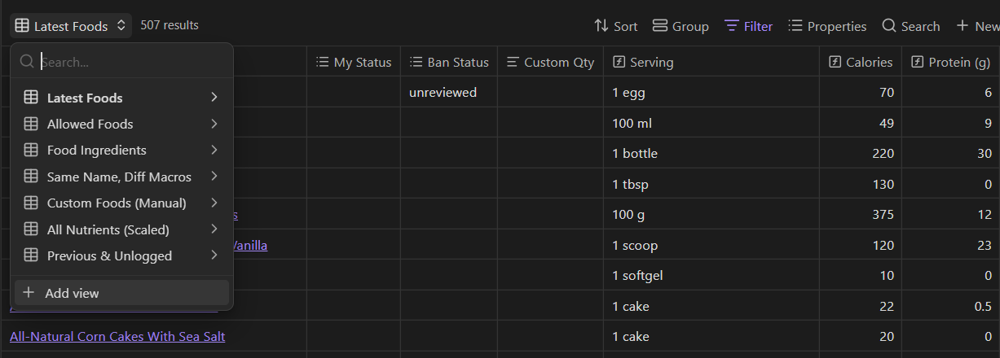
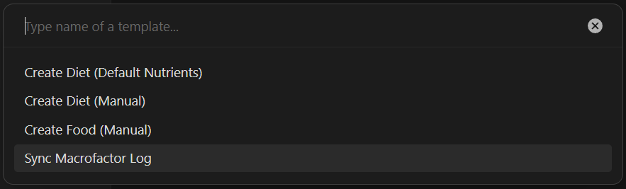
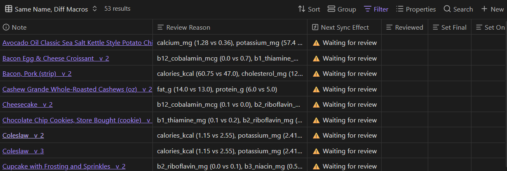

# Food Base (`unique_foods.py`)

**Your personal food database in an Obsidian Vault**.
- synchronizes with MacroFactor Food Log.
- supports Obsidian Bases Food Queries.
- supports recursive Ingredient Management.



---

> **Want the complete plug-and-play Obsidian Vault?**  
> You get the Starter Kits at **[SwitchUpCB (Food)](https://switchupcb.com/food/checkout)**.
>
> These kits include
> - **Pre-Configured Obsidian Vault**: Ready to open on Desktop, iOS, and Android with plugins pre-installed and configured.
> - **Mobile Synchronization Command** used to synchronize your MacroFactor Food Log CSV on a phone or computer.
> - **Template Commands** used to create `Food (Manual)` and `Diet (Manual, RDAs)` files.
> - `Food Database.base` used to manage foods/ingredients.
> - `Food Diet Database.base` used to manage diets.
> - `_template.base` food query saves you time creating food queries.
> - `.base` views contain 42-nutrient formulas with custom serving quantity scaling.
> - `properties.md` frontmatter autofill configuration file for property-value autocompletion in every `.md` and `.base` file.
> - **Setup Guide** which saves you time setting up your personal food database.
> 



## Table of Contents

| Section                                                                                                                                                     | Description                                                                                                        |
| :---------------------------------------------------------------------------------------------------------------------------------------------------------- | :----------------------------------------------------------------------------------------------------------------- |
| **[What does Food Base do?](#what-does-food-base-do)**                                                                                                      | Overview of MacroFactor sync, Obsidian Bases food queries, ingredient auto-banning, and diet protocols.            |
| **[Quickstart](#quickstart-how-do-you-set-up-food-base)**                                                                    | 3-step setup guide for installing dependencies, running `unique_foods.py`, and opening your vault.                 |
| **[How do you resolve foods with the same name, but different macronutrients?](#how-do-you-resolve-foods-with-the-same-name-but-different-macronutrients)** | Frontmatter controls (`reviewed`, `set_as_final_version`, `set_as_only_version`, `set_as_unique`, `duplicate_of`). |
| **[License](#license)**                                                                                                                                     | MIT open-source licensing and contribution guidelines.                                                             |


## What does Food Base do?

**MacroFactor Synchronization**
- Parses `MacroFactor-*.csv` exports into normalized `1x serving` Markdown notes inside `./food-base`. 
- Deduplicates brand suffixes into `aliases`, separates conflicting units (`cup` vs `g`), and reconciles macro mismatches deterministically without overwriting your personal notes.

**Food Queries (Obsidian Bases)** 
- Designed for native Obsidian Bases—dynamically scales `1g`/`1ml` items to `100g` (or any `custom_qty`) across all 42+ macros and micronutrients.
- Pairs with pre-filtered query templates for situational meal selection.

**Ingredient Management (4-State Auto-Ban)** 
- Audit foods as `unreviewed`, `allowed`, `banned`, or `override`. 
- Linking `[[Ingredients]]` in YAML automatically propagates `banned` status and `ban_reason: "Contains [[Ingredient]]"` across every parent food containing a blocked ingredient—and cleanly restores prior status if unbanned.

**Diets & Protocols** 
- Pair your food catalog with dedicated diet notes containing your MacroFactor calorie/macro targets, micronutrient baselines, and qualitative food trade-off rules.

## Quickstart (How do you set up Food Base?)

### 1. Install Dependencies
Requires Python 3.10+.

```bash
pip install -r requirements.txt
```

### 2. Sync Your MacroFactor Export

Drop your `MacroFactor-*.csv` export into your vault root and run the following command.

```bash
python unique_foods.py
```

_Auto-detection automatically finds the newest `MacroFactor-*.csv` in the current or parent directory (or prompts you to drag-and-drop a CSV path)._

**Optional flags**
  
```bash
# Sync a specific file into a custom folder
python unique_foods.py path/to/MacroFactor.csv --out ./food-base

# Partial sync (only process the last 30 days; skips unlogged archival)
python unique_foods.py --days 30
```

### 3. Open in Obsidian

Open your vault in Obsidian (`v1.9+` with core **Bases** enabled) to browse, filter, and manage your food database.


## How do you resolve foods with the same name, but different macronutrients?

`unique_foods.py` flags same `(food, unit)` with different nutrition numbers with  (`needs_review: true`) and an exact `review_reason` diff when MacroFactor logs the same `(food, unit)` with different nutrition numbers.



Here is how to resolve these foods using the Frontmatter/Obsidian Base table.

| Property                     | Type     | Effect on Next Sync                                                                                                                                         |
| :--------------------------- | :------- | :---------------------------------------------------------------------------------------------------------------------------------------------------------- |
| `reviewed: true`             | Checkbox | Check to dismiss the warning and keep both `previous` and `latest` versions.                                                                                |
| `set_as_final_version: true` | Checkbox | Check to set the note's macros as `latest` and stop creating versions of this food during CSV synchronization.                                              |
| `set_as_only_version: true`  | Checkbox | Check to move the macros of this onto a clean base filename, delete all other versions, and stop creating versions of this food during CSV synchronization. |
| `set_as_unique: "New Name"`  | Text     | Check to split the food variation into a unique food while preserving the original food name (from the CSV) in frontmatter property `aliases`.              |
| `duplicate_of: "[[Target]]"` | Link     | Set to merge the note's `food_name` into the target's `aliases` frontmatter property and remove the duplicate food during the next CSV synchronization.     |

---

## License

MIT License — free to use, modify, and extend.

_PRs for Cronometer, MyFitnessPal, and other food-tracking adapters are supported._
